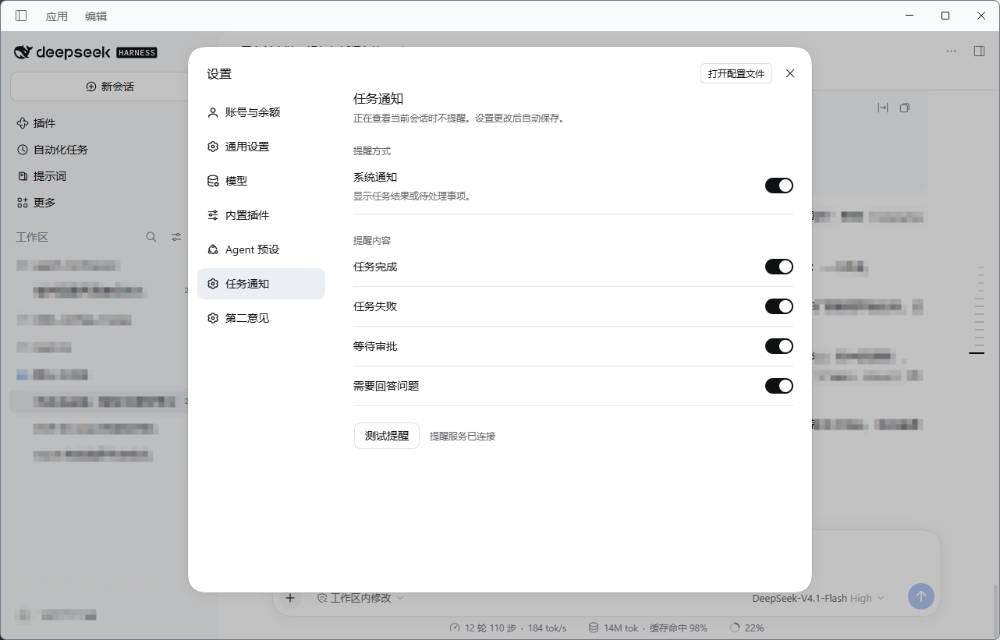
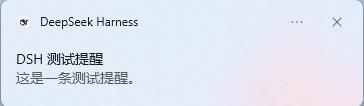

# Task notifications

[中文](README.md)

Get notified when DeepSeek Harness finishes a task or needs your input.





## Installation and use

In DSH, open **Plugins → Add plugin** and enter this GitHub URL:

```text
https://github.com/norths7ar/dsh-task-notifications
```

Install and enable the plugin, then open **Settings → Task notifications**. System notifications and all four notification types—completed, failed, awaiting approval, and awaiting an answer—are enabled by default. Each can be adjusted separately. Changes save automatically.

Click **Test notification** and switch to another app within five seconds to check the notification. Test notifications bring DSH to the foreground; task notifications also open the relevant conversation.

## When notifications appear

- No reminder appears while you are viewing the conversation. If you are on another page in DSH, a clickable in-app reminder appears instead.
- When DSH is in the background, it sends a system notification.
- Tasks that run through several turns notify you when the run ends. Manually stopping a task or finishing a subagent task does not trigger a separate completion notification.

## Compatibility and development

Tested with **DSH Desktop 0.2.2-rc.3**.

For development, use Node.js 24 and run these commands in the project directory:

```sh
npm ci
npm run check
npm run format
npm pack --dry-run
```

`check` runs lint, formatting checks, and offline tests without calling a model.

## License

[MIT](LICENSE) · [Third-party notices](THIRD_PARTY_NOTICES.md)
