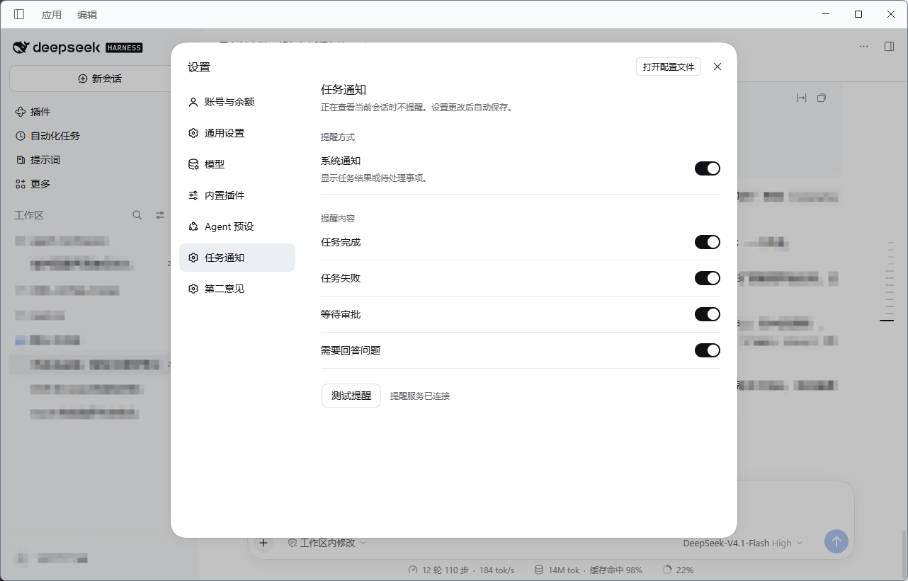
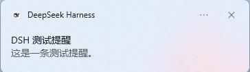

# 任务通知

[English](README.en.md)

让 DeepSeek Harness 在任务结束或需要你处理时主动提醒你。





## 安装与使用

在 DSH 的 **插件 → 添加插件** 中输入 GitHub 链接：

```text
https://github.com/norths7ar/dsh-task-notifications
```

安装并启用后，打开 **设置 → 任务通知**。系统通知，以及完成、失败、等待审批、需要回答问题这四类提醒默认开启，可以分别调整，设置自动保存。

点击 **测试提醒**，在五秒内切到其他应用，即可检查通知。测试通知只唤起 DSH；实际任务通知会打开对应会话。

## 什么时候提醒

- 正在查看当前会话时不提醒；在 DSH 中查看其他页面时，显示可点击的页内提醒。
- DSH 在后台时发送系统通知。
- 连续执行多轮的任务结束后再提醒。主动停止和子任务结束不单独发送完成提醒。

## 兼容性与开发

当前验证环境为 **DSH Desktop 0.2.2-rc.3**。

开发使用 Node.js 24，在项目目录运行：

```sh
npm ci
npm run check
npm run format
npm pack --dry-run
```

`check` 包含 lint、格式检查和离线测试，不调用模型。

## 许可证

[MIT](LICENSE) · [第三方声明](THIRD_PARTY_NOTICES.md)
